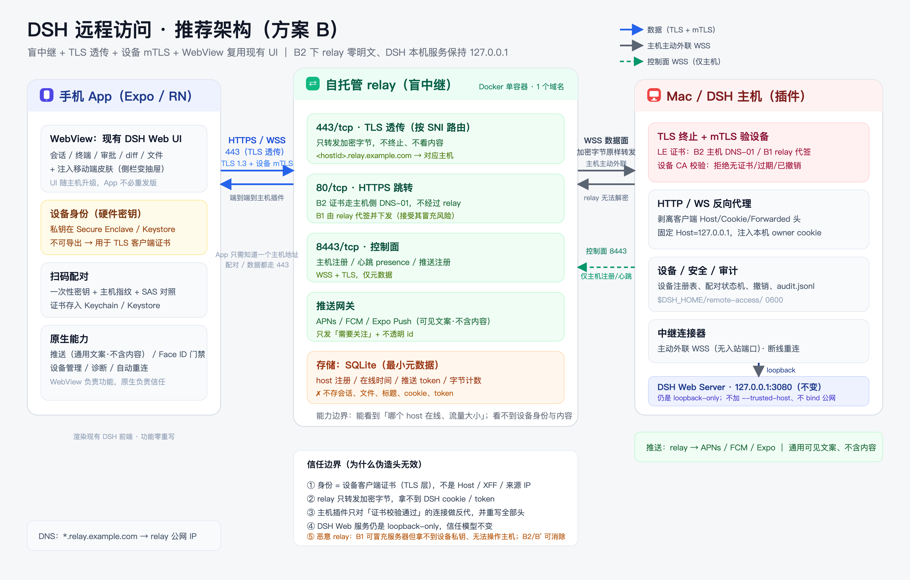
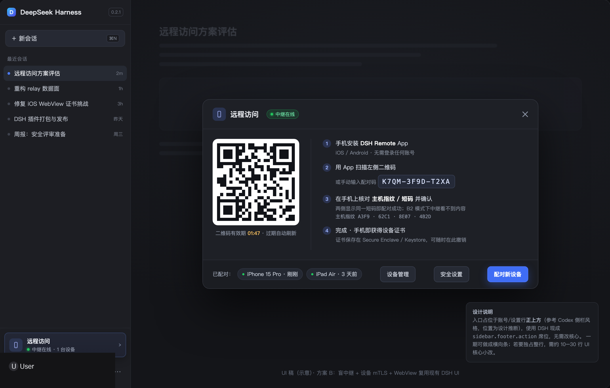

# DSH 远程访问（Codex 式手机远控）方案评估

> 版本基线：DeepSeek Harness `0.2.1-rc.2`（2026-10 安装包）
> 评估日期：2026-10-19 ｜ 性质：**评估稿，待你决策后再实施** ｜ 未改动任何代码
> 配套材料：[Codex/同类产品调研](../research/codex-reference.md)、[DSH 代码测绘](../research/dsh-architecture.md)、[安全威胁模型](../research/security.md)
> 架构图：[architecture.png](../mockups/architecture.png) ｜ 入口 UI 稿：[sidebar-entry.png](../mockups/sidebar-entry.png)

---

## 0. 一页结论（TL;DR）

**结论：这件事可行，而且比预想的省 —— DSH 已经具备相当完整的底座（Web 传输/会话/审批/插件/入口/桌面壳），真正要新建的是「设备身份 + 公网中继 + 手机壳 + 推送」。**

| 判断 | 结论 |
|---|---|
| 要不要 fork DSH？ | **不用**。一个外部 bundle 包即可同时提供 Host 插件（中继连接、配对、反向代理）和 Client UI（账号行上方入口、设置页）。安装方式：**先完全退出 Desktop** → `dsh plugin --profile desktop add <包>` → 重启 Desktop（Web 入口随页面刷新出现）；不要在 Desktop 运行时安装。 |
| 入口放哪？ | **`sidebar.footer.action`** 是现成的第三方合法席位，渲染位置在「账号/设置行」**正上方**（参考 Codex 侧栏入口风格；相对账号的精确位置是我们的设计推断）。若要做到和账号行一样独占一整行，需要 10–30 行 DSH UI 核心小改；先做横排入口可零核心改动。 |
| 手机端怎么实现？ | **App = Expo/React Native 壳 + WebView 复用现有 Web UI**（一期），原生能力负责扫码配对、设备证书（mTLS）、推送、生物识别、设备管理。这样所有功能（会话、终端、审批、diff、文件）自动可用，不必重写一套手机聊天 UI。 |
| 服务端怎么设计？ | **自托管「盲中继」**：不终止内容层 TLS（**B2 下** relay 看不到内容）。手机 ↔ 中继 ↔ 主机插件走 TLS 透传 + 设备 mTLS 证书；DSH 本机 Web 服务保持 `127.0.0.1` 不变。证书建议走 **B2**（自己域名 + 主机侧 DNS-01，连恶意 relay 都无法冒充）；图省事可用 **B1**（relay 代签，接受残余风险）。 |
| 安全上最重要的一句 | **远程身份只来自设备私钥/证书，绝不来自 Host、X-Forwarded-*、来源 IP、`isLoopback` 判定**。DSH 现有 Web 服务不直接暴露公网，也不给中继域名加 `--trusted-host`。 |
| 不建议的捷径 | 直接 `dsh web --host 0.0.0.0` + 反代 + 手机浏览器：现在只有一个 30 天的 owner cookie、无设备身份、无撤销、无登出，且 `authenticatedUrl()` 会把 launch token 拼进公告 URL（有泄露点）。详见 §3.7。 |
| 工期（强 AI 辅助、全职） | POC **1 周** + 可用 MVP（iOS，不含 POC）**5–8 周** → 公开发布版（Android/推送/加固/上架）再 **3–5 周** → 原生核心界面版再 **6–10 周**。 |
| 固定成本 | 自建 relay：1 vCPU / 1 GB VPS 约 **$5–10/月** + 一个域名（约 $10/年）；Apple 开发者 **$99/年**；其余零。 |

**建议路线：先用 Tailscale 方案（0.5–1 天）解决「现在就想在手机上看」的燃眉之急；同时用 1 周做 4 个 POC 验证最大风险；通过后直接按「方案 B（盲中继 + mTLS + WebView）」实施，不要先做会返工的可信中继版。**

需要你拍板的事项见 **§8 决策清单**（共 10 项，每项都给了选项与我的建议）。

---

## 1. 需求与参照

### 1.1 需求拆解

| # | 你的要求 | 这次评估采用的解读 | 验收标准 |
|---|---|---|---|
| 1 | 手机远程访问以 **App** 方式实现 | 一个可上架/可安装的原生 App（iOS 优先，Android 紧随）；扫码配对；手机上能看会话、发指令、批准操作、看 diff/终端 | 出门用手机能完整接手家里 Mac 上的 DSH 会话 |
| 2 | **自建服务端** | 自托管中继/网关（Docker 一键），不依赖任何厂商云；可换服务器、可撤销 | 换 VPS/服务器（保留域名）不影响 App；换域名会改变 App 访问地址，需 App 更新或重新配对；停掉 relay 手机即断；数据不落第三方 |
| 3 | **安全性**，尤其不能被头信息自称 localhost 骗过 | 设备级密码学身份；中继零知识（B2 下看不到内容）；不改变 DSH 本机信任模型；可撤销、可审计 | 构造 Host/XFF/Origin 等伪造请求无法获得任何权限；被偷手机可远程吊销 |
| 4 | 入口跟 Codex 一样在**账号上方** | DSH 侧栏底部、账号/设置行正上方加一行「远程访问」 | 一眼可见、点击进入配对/设备管理 |
| 隐含 | 低运维、断线重连、推送提醒、多设备可见、不破坏现有 Web/Desktop 体验、兼容 DSH 升级 | 纳入设计约束 | — |

### 1.2 Codex 到底是怎么做的（确认 vs 推断）

**已确认（官方文档）**
- 形态：**ChatGPT 桌面 App 当主机 → OpenAI 云中继 → ChatGPT 手机 App 内 `Codex` 入口**（旧名 `Remote`）。手机可发起/继续任务、批准命令、查看输出/diff/终端/截图、切换主机、接收通知。
- 配对：桌面 App → `Settings > Connections > Control this Mac or PC` → 显示二维码 → 手机扫码 → 确认同一 ChatGPT 账号与工作区 → MFA/SSO/passkey。每台手机 × 每台主机分别配对；手机配对**只能从桌面 App 发起**。
- 网络：官方只说 "A secure relay layer keeps trusted machines reachable … without exposing them directly to the public internet"，**没有声明端到端加密**；Codex **不可自托管**（relay、账号、策略均在 OpenAI）。
- 入口：桌面侧栏存在 "Set up Codex mobile / 设置 Codex 移动版"；手机 App 内 Codex 是一级入口。
  - 来源：<https://learn.chatgpt.com/docs/remote-connections>、<https://learn.chatgpt.com/docs/mobile>、<https://learn.chatgpt.com/docs/developer-commands?surface=cli>

**推断（不能当需求依据）**
- "入口在账号上方"：官方没有像素级说明。我们按「侧栏底部账号区之上的一行产品入口」来设计——这正好与 DSH 现有 footer 席位结构吻合（见 §6）。
- 第三方博客里的 QR 内容、mTLS、端口 47821、60 秒有效期等细节没有一手来源，不采信。

### 1.3 同类产品：Happy 是最值得抄的架构

| 产品 | 架构 | E2E | 自托管 | 手机端 | License |
|---|---|---|---|---|---|
| **Codex mobile** | 桌面主机 + 厂商云中继 | 官方未声明 | ❌ | 原生 ChatGPT App | 闭源 |
| **Happy**（slopus/happy） | 本地 Agent → **自托管盲中继**（Node）→ Expo App | ✅ QR 换一次性公钥；账号 keypair；每会话 AES-256 DEK；NaCl/AES-GCM | ✅ 单 Docker（含 PGlite） | ✅ Expo 原生 | MIT |
| **Omnara** | 可自托管 Agent 平台（Go + 出站 daemon） | 未声明 | ✅ Docker Compose | ❌ 目前 Web/CLI | Apache-2.0 |
| **VibeTunnel** | 本机服务 + 浏览器终端；远程靠 Tailscale/ngrok | ❌ | ✅ | ❌ 浏览器 | MIT |

Happy 的关键经验（也是我们方案的骨架）：
- **盲中继**：两端都出站连 relay，relay 只转发不透明 blob；内容加密在两端。
- 密钥分层：手机持有 master secret；每会话随机 DEK 用账号公钥包装后存服务端。
- relay 自己承认的元数据边界：能看到「设备/会话存在与活跃时间」，看不到内容。
- 推送内容加密/零正文。
- 单容器自托管 + App 首屏填 Server URL。

> 我们的差异：Happy 的 App 是自己的一套聊天/终端 UI；我们**复用 DSH 的 Web UI**，所以架构上要解决"WebView 怎么安全地访问远端主机"——这正是方案 B 的核心。

来源：<https://github.com/slopus/happy>、<https://happy.engineering/docs/security/>、<https://happy.engineering/docs/guides/self-hosting/>

### 1.4 三个关键判断

1. **产品形态抄 Codex，信任模型抄 Happy**：扫码配对、手机批准、看 diff/终端这些 UX 照 Codex；中继必须盲转发（或至少 TLS 端到端），不要做厂商云那套"中继可读内容"。
2. **手机配对后 = owner 级设备**，不是只读观众。理由：DSH 的审批/提问是 owner-only waterfall（`dsh-api-remote-access`/Gateway 里硬编码），要让手机"批准命令"就必须是 owner 级。这和个人使用场景（自己的手机）一致。只读/共享观众是另一个产品能力（需要 DSH 核心改动，见 §3.5），不放进一期。
3. **不要复用 DSH 的浏览器 cookie / launch token 作为远程凭证**：它们是为"本机浏览器"设计的（30 天、无设备身份、无撤销），拿到就等于 owner 全权。远程必须是**新的设备身份体系**。

---

## 2. DSH 现状盘点：能白捡什么，缺什么

> 证据来自安装包解包后的 306 个 `@deepseek-ai/*` 包（`0.2.1-rc.2`），行号以 `/tmp/dsh-extract/src/dsh/node_modules/@deepseek-ai/` 为准。

### 2.1 已经具备、可直接复用的能力

| 能力 | 现状 | 复用方式 |
|---|---|---|
| **Web 传输层** | `POST /api` 一元调用 + WebSocket `/api/remote.mux`（流、uplink、`$events`、心跳 2s、断线指数退避重连） | 手机 UI 只要加载现有 Web 前端，就自动继承这套 |
| **会话/审批/事件** | `session/list\|page\|follow\|control\|prompt\|cancel` 等 Remote；`approval/request`、`user-questions/request` 作为 waterfall 事件转发 | 远程 WebView 直接可用；审批也能在手机作答 |
| **认证链路** | 进程 launch token → `GET /` 换 HMAC 签名 cookie（HttpOnly/SameSite=Strict，30 天）；`/connect` 给非浏览器客户端发 API cookie；Peer/principal 模型 | 复用在**本机**（插件内部）；不复用到公网 |
| **自托管链路** | `dsh web --host <具体IP> --port --tls-cert/--tls-key --trusted-host --public-url` 已完整 | 作为「方案 E 直连」的基础；不是本期推荐路径 |
| **插件系统** | 一个外部 bundle 包可同时提供 Host 插件与 Client UI；`dsh plugin add <包>` 安装；desktop/web profile 均可装；已有 5 个第三方包实例 | 功能不做进 DSH 核心，做成 `dsh-remoteService` 包 |
| **入口席位** | `sidebar.footer.action`（list）渲染在账号/设置行正上方；`settings.section` 可加设置页 | 零核心改动实现入口；可选小 patch 做整行 |
| **权限引擎** | `ctx.remoteAccess` 的 role/binding/resource/snapshot/decide 已实现 | 暂时用不到（手机=owner）；未来共享观众时用 |
| **桌面 App** | Electron 壳通过 `dsh-desktop-host` 启动**同一套 Web 组合**（`127.0.0.1`、随机端口） | 插件在桌面 App 内同样生效，无需改 Electron |
| **移动端基础** | `index.html` 有 viewport、PWA manifest（fullscreen）；布局有 1024px 折叠逻辑 | 可做 WebView 壳的起点 |

### 2.2 缺口（本期要新建的）

1. **设备身份与配对**：无二维码、无设备注册表、无设备证书/密钥、无按设备撤销、无 logout。现在只有「进程 launch token → 30 天 owner cookie」。
2. **公网中继**：DSH 只有 listener 直连 + 反向代理，没有 NAT 穿透/中继服务。
3. **移动体验**：外壳是桌面三栏布局，无 Service Worker、无安全区/触控优化；且 **Web 端账号登录只接受 loopback 回调源**，远程域名下不能发起 DeepSeek 账号登录（`dsh-client-ui-settings-account/README.md:107`）。→ 手机端不登录账号，用配对身份即可；主机已登录的账号状态直接复用。
4. **推送 / 审批仲裁 / presence**：无 APNs/FCM 推送、无"哪台设备处理审批"的仲裁、无在线状态。
5. **公网安全默认值**：默认请求体上限 300 MiB、无连接/频率限制、无 HSTS/CSP、index 无 `Cache-Control: no-store`。
6. **非 owner 主体（只读观众）**：`remoteAccess` 引擎是空的——全仓没有任何 `registerPolicy` 调用，`/connect` 只发 owner Peer。要做共享观众必须补"非 owner Peer 发放入口 + 策略 + 核心改动"。

### 2.3 现有信任模型的红线（决定了架构）

安全评估结论（`research/security.md` 有完整证据）：

1. **Host/Origin 栅栏只防 CSRF/DNS-rebinding，不建立身份**：`Host: localhost` 只能让你走到鉴权门口，没有签名 cookie 照样 401。
2. **`X-Forwarded-For` / `X-Real-IP` / `Forwarded` / `X-Forwarded-Host/Proto` 在整个 DSH 里零读取**；cookie 的 `Secure`/scheme 只由本监听器 TLS 决定，不看 `publicUrl` 或转发头。
3. **身份只有四样东西**：launch token、HMAC 签名 cookie、`/connect` API cookie、进程内 `createPeer`。源 IP、Host、Origin、loopback 判定、TLS 证书都**不是**身份。
4. **`publicUrl` 不授权，但 `authenticatedUrl()` 会把 launch token 拼进公告 URL** —— 如果把它指向公网中继，owner 引导令牌就可能进中继/代理的 URL 日志。远程场景必须避开。
5. **30 天 owner cookie，无登出、无按设备撤销、无速率限制**。互联网暴露 = 把 owner 全权交给 cookie 持有者。
6. **客户端 `isLoopback` 仅喂 UX**（设置文档存储、目录选择器 backend），没有任何网络授权依赖它；不能伪造它来提权，也没必要伪造。

**所以：远程路径绝不能是"把 dsh web 直接暴露/反代出去"，必须是"新鉴权层 + 真正的端到端传输"。**

> ⚠️ 本文的推荐实现（WebView 复用、整站反代、手机 = owner、X.509 设备证书）在若干点上**有意偏离** `research/security.md` 的 MUST 基线，逐条偏离、理由、补偿与残余风险见 **§5.13**。不要把本文读成"满足 security.md 全部 MUST"。

### 2.4 需求 → 现有能力 → 缺口

| 需求 | 现有可复用 | 需要新建 |
|---|---|---|
| 手机看会话/发指令/批准 | 现有 Web UI + `/api` + `/api/remote.mux` + 转发事件 | 手机壳 + 远程代理 |
| 安全身份 | Peer/principal 模型、cookie 机制（仅本机） | 设备密钥/证书、配对、mTLS、撤销 |
| 自建服务端 | `dsh web` 的 TLS/trustedHosts 链路 | 盲中继（控制面 + 数据面 + 证书自动化） |
| 入口在账号上方 | `sidebar.footer.action` 席位 | 入口 UI/弹窗/设置页 |
| 推送 | 现有会话事件（turn/end、approval/request） | relay 推送通道 + App 推送注册 |
| 断线重连 | Connection 重连、Gateway mux | App 后台/前后台重连策略 |

---

## 3. 方案空间与对比

### 3.0 评估维度

安全（中继能否读内容 / 身份强度 / 可撤销性）、工期、运维成本、与 DSH 的复用度、上架风险。

### 3.1 六个候选方案

| 方案 | 一句话 | 中继能否读内容 | 自建服务端 | App 形态 | 复用现有 UI | 工期（强 AI 全职） | 主要风险 |
|---|---|---|---|---|---|---|---|
| **0. Tailscale/Headscale** | 官方 Tailscale App + 手机浏览器/PWA 打开 DSH | 否（WireGuard E2E） | Headscale 可自建 | ❌ 非自有 App | ✅ 全部 | **0.5–1 天** | 无自有 App、30 天 cookie、无设备撤销、体验一般 |
| **A. 可信中继 + WebView** | relay 终止 TLS 并转发 HTTP/WS；设备 token | **是**（自托管信任域内） | ✅ | WebView 壳 + 原生外设 | ✅ 全部 | **3–4 周** | 中继被攻破=内容泄露；安全债；后面要返工 |
| **B. 盲中继 + mTLS + WebView** ⭐ | relay 只透传 TLS；主机插件终止 TLS；设备证书 mTLS | **否**（E2E TLS） | ✅ | WebView 壳 + 原生外设 | ✅ 全部 | **5–7 周** | 公网域名/证书、WebView mTLS 有 POC 风险 |
| **C. B + 原生核心界面** | 再写原生会话/审批/diff/终端界面 | 否 | ✅ | 原生 + WebView 兜底 | 部分 | **+6–10 周** | 界面工作量大、DSH 数据面协议耦合 |
| **D. 改造 Happy（MIT）** | fork Happy 的 relay+Expo App，写 DSH 适配 daemon | 否（E2E） | ✅ | 原生（Happy UI） | ❌ 自己一套 UI | **4–6 周？** | 吃透代码/长期分叉/UI 不匹配 |
| **E. 直接公网反代现有 dsh web** | `--host`/反代/`--trusted-host` + 手机浏览器 | 是（反代可读） | 部分 | ❌ 浏览器 | ✅ 全部 | **1–3 天** | 单 cookie 无设备身份、token 泄露、无撤销 —— **不建议** |

> 工期口径：假设你全职投入、大量使用 AI 编码代理（约 0.5–0.7x 人工量），且 iOS 优先。业余时间按 ×2~3 估。

**术语（后文反复用到）**
- **A** = 可信中继：relay 终止 TLS 并转发 HTTP/WS，设备用 bearer token。快，但 relay 可见内容。
- **B** = 盲中继 + TLS 透传 + 设备 mTLS（推荐）。按"主机 TLS 证书从哪来"分两种：
  - **B1** = 证书由 relay 代签/下发（relay 可见私钥）：省事，但 relay 能拿到同名证书 → **恶意 relay 可冒充服务器**（但仍拿不到设备证书，无法以设备身份操作主机）；
  - **B2** = 自己域名 + **主机侧 DNS-01**（DNS API 凭据只在主机）：relay 既拿不到私钥也改不了 DNS → **恶意 relay 连冒充服务器都做不到**；代价是你要把 DNS 服务商的 API token 交给主机插件（0600）。
- **B′** = 盲中继 + 应用层 Noise/AEAD 端到端 + App 内本地 HTTP/WS 代理（WebView 指向 `127.0.0.1`）：不依赖 WebView mTLS，但 App 原生工作量最大；作为 mTLS POC 失败时的回退。
- **C** = 在 B/B′ 之上做原生化界面（会话/审批/diff/终端）。
- **D** = 改造 Happy（MIT）作为 relay+App 基线；**E** = 直接公网反代现有 `dsh web`（不推荐）。

### 3.2 方案 0：Tailscale 立即用（推荐作为「今天就能用」的过渡）

做法：
1. Mac 与手机装 Tailscale（免费版够用；想完全自建可上 Headscale）。
2. Mac 上 `tailscale serve --bg 3080`（或直接 `dsh web --host <Tailscale IP>` + 自签 TLS）。
3. `dsh web` 启动参数加 `--public-url https://<machine>.<tailnet>.ts.net/` 和 `--trusted-host <machine>.<tailnet>.ts.net`；用启动日志里的 tokenized URL 在手机浏览器打开一次，cookie 写入后即可用。
4. 想更像 App：把这套 URL 包一个 5 分钟的 WebView 壳（无需配对/推送）。

> 注意：Tailscale Serve 在它那一端终止 TLS，所以 DSH 侧的 cookie 不会带 `Secure`；只应在 tailnet 内这样用。

优点：**当天可用**、零代码、WireGuard 本身是强加密、无厂商中继。
缺点：不是你的 App、无配对/设备管理/推送、30 天 owner cookie、Tailscale 账号体系（或用 Headscale 自建）。

**建议：先这样用起来，验证"手机操作 DSH"的真实需求，再决定是否投入 B。**

### 3.3 方案 A：可信中继 + WebView（快速版）

```
手机 WebView ── HTTPS ──> relay（终止 TLS，转发 HTTP/WS）── WSS 隧道 ──> 主机插件 ──> 127.0.0.1 DSH
```

- relay 用自有域名 + Let's Encrypt；设备首次配对拿一个设备 token（HttpOnly cookie 或 URL 一次性），relay 校验后转发；主机插件再注入本机 owner cookie。
- 工期比 B 少约 1.5–2 周（不用做 TLS 透传/证书自动化/WebView mTLS）。
- **代价**：relay 能看到全部会话内容；设备身份是 bearer token 而非证书；一旦 relay 被入侵或运维日志不当，等于 owner 失守。对"自己 NAS/自家 VPS 上单人使用"可以接受，但不满足"强安全"目标。

**建议：只在"必须 2 周内出可用版"时选；否则直接做 B，避免安全模型返工。**

### 3.4 方案 B：盲中继 + mTLS + WebView ⭐（推荐目标）

核心思路：**relay 是哑的 TCP/TLS 管道**；TLS 在主机插件那里终止（端到端）；手机用 **设备客户端证书（mTLS）** 证明身份；主机插件验证证书后再反向代理到 `127.0.0.1` 的 DSH Web 服务。

```
┌───────────────┐        ┌──────────────────────────────┐        ┌─────────────────────────────┐
│ 手机 App       │        │ 自托管 relay（盲）             │        │ Mac / DSH 主机               │
│ Expo + WebView │        │ Docker 单容器                  │        │ dsh-remoteService 插件        │
│                │        │                              │        │                             │
│ 设备私钥/证书  │──TLS──▶│ 443: 按 SNI 路由 → TCP 透传    │◀─WSS──│ 主机主动外联（无入站端口）     │
│ (Enclave/      │  mTLS  │ 80:  跳转（B1 时回源 ACME）    │ 数据面 │ 主机 TLS 终止（mTLS 验设备）   │
│  Keystore)     │        │ 8443: 控制面（主机注册/推送）   │ 控制面 │ HTTP/WS 反代 → 127.0.0.1:3080 │
│ 扫码配对/推送   │        │ 不落内容、不见明文              │        │ 设备注册表/审计/推送触发       │
└───────────────┘        └──────────────────────────────┘        └─────────────────────────────┘
```

为什么它能满足要求：
- **"不能被头信息骗"**：身份 = TLS 客户端证书（设备私钥在 Secure Enclave / Android Keystore），跟 Host、XFF、来源 IP 完全无关。relay 只能在 TLS 之外转发字节，改不了证书。
- **B2 下 relay 零明文**：TLS 端到端；relay 看不到会话内容，也拿不到 DSH 的 cookie/token（B1 需接受 relay 可冒充服务器的残余风险，见 §4.8）。
- **DSH 本机信任模型不变**：不 bind 公网、不把 relay 域名加进 `trustedHosts`；DSH Web 服务只接受来自本机插件的 loopback 请求，插件注入本机 owner cookie（或走进程内 Peer）。
- **可撤销**：主机侧设备注册表 + 证书白名单/CRL；撤销即断链。
- **复用现有 UI**：手机 WebView 直接加载经过代理的 DSH Web UI，所有功能自动可用。

技术风险与对策（POC 周验证）：
1. **WKWebView / Android WebView 的 mTLS 客户端证书支持**：`WKNavigationDelegate.didReceive challenge` 可响应客户端证书挑战（iOS 上已有 Entra ID 条件访问等生产案例）；Android 用 `WebViewClient.onReceivedClientCertRequest`。→ **最高风险项，第 1 周 POC**。失败则退方案 A 或 B′（App 内本地代理）。
2. **公网证书自动化**：推荐 **B2 = 主机侧 DNS-01**（用 DNS 服务商 API 给 `<hostid>.relay.example.com` 签单域名证书；私钥不出主机，relay 无法拿到同名证书）。备选：**B1 = relay 代签并下发证书**（省事，但等于把"服务器身份"托付给 relay，威胁模型要接受这一点）。
3. **反向代理要完整支持 Web UI**：HTTP keep-alive、gzip、multipart 上传、Range 下载、WebSocket upgrade、大请求体。→ POC 用真实 UI 跑一遍会话/终端/上传/导出。

### 3.4.1 可选变体：有公网 IP 时的「直连模式」（省掉 relay）

如果家里/公司有**公网 IP 或 DDNS**，可以不做中继：把主机插件的 TLS 监听绑到一个具体接口（LAN/公网 IP），路由器做端口映射，手机直接连 `<你的域名>:<端口>`。安全模型与 B2 相同（TLS + mTLS + 主机指纹），少一台服务器、少一个故障点。
代价：暴露家庭/公司公网 IP；CGNAT、运营商封锁 443/端口、动态 IP 都要处理；没有 relay 的推送/多主机路由；TLS 证书仍可用 DNS-01。**作为高级可选模式，不替代标准 relay 方案。**

### 3.5 方案 C：原生化演进（Codex 级体验，二期之后）

在 B 之上增加原生界面：会话列表、聊天流（Markdown/代码/diff）、审批卡片、通知深链、原生终端。WebView 作为"完整功能"兜底。
- 数据面可以用 DSH 现有 Remote 协议（`/api` + mux）在 App 内实现原生客户端；或直接复用 WebView 里的 JS。
- 只读/共享观众（非 owner）需要 DSH 核心改动：新增非 owner Peer 发放入口 + `remoteAccess.registerPolicy` + 审批仲裁，属于独立项目。

### 3.6 方案 D：改造 Happy（可选加速项）

Happy 是 MIT、架构同构，理论上可以 fork 其 relay + App，自己写一个「DSH daemon」把 DSH 会话包装成 Happy 协议。
- 省：中继、E2E、配对、推送、App 外壳（约 50–60% 基建）。
- 费：Happy 的 App UI 是它自己的聊天/终端形态，和 DSH 的卡片/审批/diff UI 不一致；要长期跟上游分叉；它的 daemon 协议要适配 DSH 会话。
- **结论：如果你想快速得到一个"能用的 Codex 式 App"且不介意它不像 DSH，这是备选；否则自建更可控。**

### 3.7 方案 E：直接公网反代现有 dsh web（明确不推荐）

看起来最省（1–3 天）：
```
手机浏览器 → nginx/Caddy（TLS）→ dsh web --host 127.0.0.1 --trusted-host your.domain
```
但：
- 身份只有 30 天 owner cookie，**无设备身份、无登出、无按设备撤销**；
- `authenticatedUrl()` 会把 launch token 拼进 `--public-url` 公告 URL，容易进反代/日志；
- 反向代理若终止 TLS，cookie 与全部内容对代理可见；DSH 侧 cookie 还不会带 `Secure`；
- 无速率限制、300 MiB 请求体、静态资源公开、无 HSTS/CSP；
- 手机端账号登录不可用、无推送、无配对 UX。
→ 仅适合"只在 Tailscale/私有 VPN 内用"的场景。

### 3.8 推荐路线图

```
第 0 阶段（0.5–1 天）   Tailscale + 手机浏览器/PWA，先能用
第 1 阶段（1 周）        4 个 POC（WebView mTLS 含 WS / relay 透传 / 代理后 UI 全功能 / 证书签发）→ go/no-go
第 2 阶段（5–8 周）      MVP：方案 B（iOS + WebView + 配对 + 设备管理 + 入口 + 基础推送/安全）
第 3 阶段（3–5 周）      发布版：Android、推送完善、审计/加固、TestFlight/上架、部署文档
第 4 阶段（6–10 周）     原生化：原生会话/审批/diff/终端 + 可选 LAN 直连/多主机/共享观众
```

如果第 1 周 POC 的 WebView mTLS 不通过 → 退方案 A（可信中继）或 B′（App 内本地代理 + Noise E2E），架构图其余部分不变。

---

## 4. 方案 B 详细设计

### 4.1 组件与职责



| 组件 | 位置 | 职责 |
|---|---|---|
| **`dsh-relay`**（自托管） | 你的 VPS / NAS（有公网域名） | 控制面：主机注册、心跳/presence、推送触发、路由表；数据面：443 按 SNI 做 TCP 透传、80 只做 HTTPS 跳转；元数据存储（SQLite）；TLS 1.3；限流。**B2 下零明文；B1 会代签证书（可冒充服务器，见 §4.8）** |
| **`dsh-remoteService`**（DSH 插件包） | 主机（Mac）内 | Host 半：主机身份密钥、设备 CA/注册表、配对状态机、TLS 监听（mTLS）、HTTP/WS 反向代理到 loopback、中继连接器、推送触发、审计。Client 半：账号行上方入口、配对弹窗、设备管理、设置页、移动端 CSS |
| **`dsh-remoteApp`**（Expo/RN App） | iOS / Android | 扫码配对、设备密钥/证书（Secure Enclave/Keystore）、WebView 承载 DSH UI 并响应 mTLS 挑战、推送、生物识别门禁、连接状态、设备管理、诊断 |
| **共享协议包**（可选） | monorepo | relay 控制面消息、配对消息、QR 载荷的 zod schema/类型 |

**目录建议（沿用你已建的两个空目录）：**
```
dsh-remote/
├── dsh-remoteService/        # pnpm monorepo
│   ├── packages/host-plugin/ # DSH bundle：index.js(host) + client.js + cordis.patch.yml
│   ├── packages/relay/       # 自托管中继（Docker 单镜像）
│   ├── packages/protocol/    # 共享类型/常量
│   └── docker/               # compose + Caddy/环境变量模板 + 部署文档
├── dsh-remoteApp/            # Expo 工程（iOS/Android）
├── docs/                     # 本评估 + 设计/部署文档
├── mockups/                  # UI/架构图
└── research/                 # 调研与代码测绘（已完成）
```

### 4.2 数据流

**手机加载 UI（日常路径）**
```
WebView https://<hostid>.relay.example.com/
  → DNS(*.relay.example.com) → relay:443
  → relay 读 TLS ClientHello 的 SNI，按 <hostid> 查路由
  → 把原始 TLS 字节经主机已建立的 WSS 数据通道转发
  → 主机插件本地 TLS 监听（127.0.0.1:随机端口）
      · 出示 <hostid>.relay.example.com 的 LE 证书（私钥在主机）
      · 要求并校验设备客户端证书（mTLS；CA 是主机自己的设备 CA）
  → 校验通过：HTTP 反代到 127.0.0.1:<dshPort>
      · 剥离客户端 Cookie/Forwarded/等头，强制 Host=127.0.0.1:<port>
      · 注入插件在进程内换到的浏览器 session cookie
      · WebSocket upgrade 同样代理（/api/remote.mux）
  → DSH Web 服务看到的是「本机 loopback + 已认证 owner cookie」
```
数据面上 relay 只转发加密字节（B1/B2 相同；B1 的额外风险是 relay 可代签同名证书冒充服务器，见 §4.8，而不是解密现有流量）；DSH 的 cookie/token **从未离开主机**。

**控制面（只有主机连 relay，App 不参与 relay 控制面）**
```
主机插件 --WSS(8443/control)--> relay   （主机 token 认证；注册/心跳/推送注册）
App 配对 --HTTPS(443 透传)--> <hostid>.relay.example.com/__dsh_remote/pair   （一次性配对密钥）
App 推送 token --mTLS(443 透传)--> 主机插件 /__dsh_remote/push-token        （主机再转给 relay）
relay 推送 --HTTPS--> APNs / FCM / Expo Push                                 （通用可见文案、不含内容）
```
> 这样 App 只需要知道一个主机地址，不需要 relay 账号/控制面。**换服务器但保留域名**只影响主机配置；**换域名**会改变 App 的访问地址，需要 App 侧更新配置或重新配对。

### 4.3 配对流程（首次）

1. 桌面/Web 的入口点击「开启远程访问」→ 插件生成/加载：主机身份密钥（Ed25519）、设备 CA、向 relay 注册主机（拿到 `hostid`/子域名）。
2. 选「配对新设备」→ 生成**一次性配对密钥**（32B，120 秒有效，单次使用），显示二维码：
   ```
   dshremote://pair?v=1&host=<hostid>.relay.example.com&secret=<base64url 一次性密钥>&hostfp=<base64url(SHA-256(主机身份公钥))>&exp=<过期时间戳>
   ```
   > 实际二维码是**单行 URI + 百分号编码**（上面折行仅为可读性示例）。QR 里**只有**一次性密钥，没有长期 token、没有 cookie；`hostfp` 放**完整** SHA-256（短指纹只用于屏幕人工对照，不作为 pin）。
3. 手机扫码：App 生成设备密钥对（私钥进 Secure Enclave / Android Keystore，永不导出），连到 `<hostid>.relay.example.com/__dsh_remote/pair`。
4. TLS 握手：主机出示 LE 证书；App 同时校验 `hostfp`（防中继/域名劫持下的 HTTPS 层，需 POC 验证 WebView 之外的原生连接可做 pinning）。**配对路径**在 TLS 层允许不带客户端证书（只允许这一个接口），由一次性密钥 HMAC 挑战 + 限速保护；**配对完成后，除 `/__dsh_remote/pair` 外的所有路径都要求 mTLS 设备证书**。
5. App 提交设备公钥（CSR）+ 设备名/平台。
6. 桌面弹出配对确认：显示设备名 + **SAS 短码**（`HMAC-SHA256(secret, hostPub || devicePub || "dsh-pair")` 截断，**绑定了主机公钥与设备公钥**），与手机屏幕对照一致 → 用户点「允许」。
7. 主机设备 CA 签发设备证书（绑公钥/设备 id/用途；默认 30 天，可配置 7–90 天，自动续期），返回给 App 存入 Keychain/Keystore；**本次配对会话的一次性密钥立即作废**（配对路由保留，供以后添加设备）。
8. relay 只知道"某 host 发生了配对"，不知道内容；设备列表与撤销都在主机侧。

### 4.4 身份与密钥层级

| 凭据 | 生成位置 | 存储 | 用途 | 生命周期 |
|---|---|---|---|---|
| 主机身份密钥（Ed25519） | 主机插件 | `$DSH_HOME/remote-access/` 0600 | 主机指纹/配对确认 | 长期，可轮换（重配） |
| 设备 CA（P-256/Ed25519） | 主机插件 | 同上 | 签发/校验设备证书 | 长期 |
| 设备私钥（P-256） | 手机 Secure Enclave / Android Keystore | 不可导出 | mTLS 客户端认证 | 设备生命周期 |
| 设备证书 | 主机 CA 签发 | 手机 Keychain/Keystore | mTLS 身份 | 默认 30 天（可配 7–90）自动续期，可撤销 |
| TLS 服务端证书 | 主机插件（B2：主机侧 DNS-01；B1：relay 代签） | 主机 0600 | `<hostid>.relay.example.com` HTTPS | 90 天自动续期 |
| relay 主机 token | relay 首次启动生成 | relay + 主机 0600 | 主机注册控制面 | 长期，可重置 |
| 推送 token | APNs/FCM/Expo | relay/主机 | 推送唤醒 | 可随设备撤销 |

### 4.5 自托管 relay 设计

**技术栈建议：TypeScript（Node 24）+ `ws` + `acme-client` + SQLite。** 理由：和 DSH 插件同语言、共享协议类型、迭代最快（Happy 也证明了 Node relay 可行）。Go 版可作为 V2 单二进制（协议不变）。
> 注意：Node 做"TCP 透传 + SNI 解析"要自己写 ~100 行 ClientHello 解析或用现成库；如果觉得这层不放心，用 Go（`crypto/tls` + 手写 peek 或 `tcpproxy` 库）实现 relay 数据面，控制面仍可用 TS。**建议先用 Node 出 MVP。**

**端口与 DNS**
- `443/tcp`：TLS 透传（按 SNI 路由到主机）；relay 自身不终止。配对和日常数据都走这里。
- `80/tcp`：只做 301 到 HTTPS。**不**承担任何 ACME 回源（B2 走主机侧 DNS-01；B1 由 relay 在控制面向主机下发证书）。
- `8443/tcp`：控制面 WSS（relay 自己终止 TLS，用 `relay.example.com` 的 LE 证书；**只有主机连接**，App 不连）。
- DNS：`relay.example.com` A → relay；`*.relay.example.com` A → relay（泛解析）。
- 主机子域名：`<hostid>.relay.example.com`。**B2（推荐）**：主机插件用 DNS 服务商 API（权限仅限 `_acme-challenge` TXT）做 DNS-01，自己申请/续期证书；relay 不参与证书链。**B1**：relay 代为申请并下发该子域的证书与私钥（relay 可见私钥，因此可冒充服务器，见 §4.8）。

**数据面协议（主机 ↔ relay，WSS 多路复用）**
```
host.open{streamId}  → relay: 新到一条 443 连接（SNI=<hostid>）
host.ready{streamId}
host.data{streamId, bytes}   (双向，二进制帧，ack/窗口做背压)
host.close{streamId, reason}
```
主机侧收到 `host.open` 后连本机 TLS 监听端口，双向 pipe。relay 侧对每条公网 TCP 连接做一个流，超时/空闲回收，限制并发/字节配额。

**控制面协议**
```
host.register{hostToken, hostName, hostId?, identityPubkey}  → {hostId, hostName}
host.heartbeat{load, online}
push.register{deviceId, provider, token}
push.send{opaqueDeviceIds, kind}     // 内容无关，只有"需要关注"
```
relay 只存：host 记录、推送 token、最后在线时间；**不存会话内容/文件/标题**。

**主机注册与证书签发的先后顺序（重要）**
1. 主机插件先在控制面 `host.register` 拿到 `hostid`/子域名（DNS 泛解析需事先指向 relay）→ 2. **B2**：主机插件用 DNS-01 拿到证书；**B1**：relay 代签并通过控制面把证书/私钥下发给主机 → 3. 启动 TLS 监听 → 4. 生成配对二维码。首次配置需要主机在线且 relay 可达（B2 还需要 DNS API 凭据），失败要在入口 UI 给出可读的排障状态。

**推送**
- 一期最省：relay 走 **Expo Push Service**（App 用 Expo 生成 token；payload = **通用可见文案（如「DSH：有任务需要你」）+ 不透明 id，不含会话/内容**）。iOS 静默推送不保证送达，故不用纯静默；元数据会经过 Expo，介意则二期换直连 APNs/FCM。
- 二期：relay 持 APNs key / FCM 项目，直连；payload 只有不透明 device/kind，正文等 App 连上后经 E2E 拉取。
- 触发点：主机插件监听 `session/event` 的 turn 结束/失败、`approval/request`、`user-questions/request`；按设备偏好发。

**部署（一期）**
```yaml
# docker-compose.yml（概念）
services:
  relay:
    image: ghcr.io/<you>/dsh-relay:0.1
    restart: unless-stopped
    ports: ["80:80", "443:443", "8443:8443"]
    environment:
      RELAY_DOMAIN: relay.example.com
      RELAY_ACME_EMAIL: you@example.com
      RELAY_DB: /data/relay.sqlite
      PUSH_PROVIDER: expo          # or apns/fcm/none
    volumes: ["relay-data:/data"]
```
首次启动把 **host token 写入 `/data/secrets/host-token`（0600）**（或一次性 TTY 输出，绝不写常规日志）；`relay token create/rotate` 生成新 token。host token 与 `hostId` 绑定，重复注册同一 hostId 默认拒绝（需显式 rotate）。部署文档给出 DNS、端口、备份、升级、日志脱敏、健康检查。

**运维要点**
- 服务器只做转发，CPU/内存很低；带宽 ≈ 手机与主机的实际操作流量（聊天/终端很小，文件预览略大）。
- 可用性：relay 挂了 = 手机连不上但主机不受影响；主机睡眠 = 手机显示离线（推送提醒 + 建议常开设备/防睡眠）。
- 日志只记 stream id/字节数/错误码，不记 Host 以外的身份信息，不记内容。
- 证书到期前自动续；主机离线时续期失败要告警。

### 4.6 与 DSH 的集成点（插件落位）

| 事项 | 落位 |
|---|---|
| 主机插件入口 | 包根 `index.js` 导出 Cordis 插件（`name/inject/apply/Config`），`cordis.patch.yml` 里 `insert` 一行 |
| 中继连接器 / TLS 监听 / 反向代理 | Host 插件内（Node `https` + `ws` + 自写 proxy；或 `http-proxy` 类库） |
| 取本机 owner 凭证 | `ctx.connection.authenticatedUrl(baseUrl)` 拿带 token 的 URL → 本机 `fetch` `GET /?token=…`（manual redirect）解析 `Set-Cookie` → 内存 cookie jar；定时重取 |
| 反代到 DSH | 固定上游 `http://127.0.0.1:<ctx.webServer.port>`；HTTP/WS 都代理；**不改 `--trusted-host`、不 bind 公网**。剥离 `Cookie/Authorization/Host/Origin/Sec-Fetch-*/Forwarded/X-Forwarded-*`，统一重写 Host（WS 升级也必须剥/重写 Origin，见 §5.2）。若用户给 `dsh web` 配了本机 TLS，插件需按 https 连 loopback（MVP 限定桌面 App 默认的 HTTP loopback，文档写明） |
| 远程路径 allow/deny | **allow**：`/`、`/index.html`、`/assets/*`、`/plugins/*`、`/favicon*`、`/manifest*`、`/api/*`（Remote 业务调用）、WS `/api/remote.mux`。**deny**：`/connect`、`/oauth/*`、`/__dsh_remote/*`、`/api/remote-access/*`（本机管理）、以及 open-in-app / 目录选择器 native 等"本机副作用"路由；DSH 升级后按插件清单复核 deny list。 |
| 入口 UI | Client 半 `ctx.slots.inject('sidebar.footer.action', …)` 注册一行（账号行上方）；`settings.section` 注册设置页 |
| 移动端适配 | Client 半注入 CSS/布局（WebView 加载时带 `?dsh_mobile=1` 或 UA 判断）；不改 App 即可迭代 |
| 配对/设备管理 API | 插件在 DSH webServer 注册 `/api/remote-access/*` 本机路由，用 `ctx.connection.requestRejection(req)` 做本机浏览器认证；该路由对远程代理**明确 deny**（远程角色走插件 TLS 通道的 `/__dsh_remote/*`）。 |
| 审计 | Host 插件写 `$DSH_HOME/remote-access/audit.jsonl`（0600，内容哈希而非内容） |
| 推送触发 | Host 插件监听会话事件 → relay push API |
| 版本兼容 | `package.json` 的 `engines.dsh` 限定兼容范围；对 `ctx.connection`/`ctx.slots`/`ctx.webServer` 等公开服务做启动自检，不兼容时明确报错而不是半工作 |

**关键实现细节（已验证可行性的依据）**
- 插件可以拿到 `ctx.connection.authenticatedUrl()`（Connection 服务公开方法）和 `ctx.webServer.port`（Web 服务公开 getter）。
- Client 插件确实可以有 CSS 副作用：DSH 的 client module 体系支持插件 bundle 注入/卸载全局样式（`dsh-client-ui-theme` 就是这样）。
- `sidebar.footer.action` 是 list 席位，渲染顺序在 `sidebar.settings`（账号行）之前 —— 见 §6。
- 桌面 App 内同样有这套 web composition（`dsh-desktop-host` 启动 `--host 127.0.0.1 --port 0`），所以插件在桌面 App 里同样工作；**不要**尝试改 Electron 壳的启动参数。
- 本机 Web 服务只 **bind loopback**；DSH **不校验来源 IP**，所以"只接受本机插件请求"是部署事实（唯一对外入口是插件的 TLS+mTLS 监听），不是 DSH 的授权保证；本机同 uid 进程仍是信任边界。
- **主机形态建议（重要）**：远程场景建议跑**独立 `dsh web --profile web` 实例 + launchd 常驻**，Desktop App 只作本机客户端。理由：Desktop 退出/重启会中断远程；独立实例固定端口、插件安装/重启更可控。若坚持用 Desktop 常开，需要接受"退出 App = 远程断开"。
- 反代时 DSH 前端会认为 `location.hostname` 是 relay 域名（`isLoopback=false`）：影响的是「本机设置文档存储」和「目录选择器 backend」等 UX，不是安全；远程时自动降级，**不用伪造 isLoopback**（伪造反而容易误导 UI）。这一点要在验收中明确接受。
- 远端 UI 上 **DeepSeek 账号登录不可用**（Host 只接受 loopback 回调源）：移动皮肤应隐藏/禁用该入口，设置页提示「账号相关操作请在主机完成」；主机已登录时远端仍能正常显示账号状态。

### 4.7 App 设计（一期：WebView 壳）

**技术栈：React Native + Expo（EAS Build / TestFlight / Play internal），原生模块只在必要处写（mTLS、密钥/CSR、推送、生物识别）。**

> **与调研结论的偏离**：`research/codex-reference.md` §5 建议"WebView 仅作 demo、不做主客户端"（担心 4.2 审核与体验）。本文把它作为**一期主客户端**，理由是：复用全部功能、上线快、UI 随主机升级。代价是 4.2 审核风险与移动体验一般；若一审被拒或体验不达标，fallback = 原生会话/审批/diff 页 + WebView 兜底（进入二期）。

页面/能力：
1. **配对页**：扫码（expo-camera）/手动输码；显示主机名与指纹；配对中/SAS 确认/成功/失败重试。
2. **主界面**：全屏 WebView 加载 `https://<hostid>.relay.example.com/`；顶部细条（连接状态/主机名/返回）；下拉刷新；外部链接用系统浏览器打开；文件上传走 WebView 原生选择器；下载走分享面板。
3. **连接管理**：主机列表（一期单主机）、在线/离线、重连、切换（多主机是二期）。
4. **设备与安全**：当前设备证书信息、重新配对、从主机侧吊销提示；App 锁（Face ID/Touch ID/指纹）。
5. **推送设置**：开关、免打扰、哪些事件推。
6. **诊断**：relay 连通性、证书到期、版本、导出日志（脱敏）。

原生模块清单（一期）：
- mTLS 客户端证书挑战：iOS `WKNavigationDelegate.didReceive challenge` + `SecIdentity`（Keychain/Secure Enclave）；Android `WebViewClient.onReceivedClientCertRequest` + `KeyStore`/`PrivateKey`。
- 设备密钥生成 + CSR（P-256；iOS Security.framework / Android Keystore + BouncyCastle 或小型 DER 编码器）、证书导入 Keychain/Keystore。
- 生物识别（`expo-local-authentication` 够用）。
- 推送（`expo-notifications`，一期 Expo Push）。拿到 push token 后，App 用**设备证书 + 原生 HTTP 客户端**请求主机插件的 `/__dsh_remote/push-token`（走 443 透传），由主机登记并转交 relay；relay 不需要 App 直连控制面。推送用**通用可见文案（不含内容）+ 不透明 id**；纯静默推送不可靠，需在 POC 验证。
- 安全存储（`expo-secure-store` 存非密钥类凭据；私钥必须走 Keychain/Keystore 原生）。

**App 审核注意**（很重要，影响一期设计）：
- Apple **4.2 Minimum Functionality**：纯 WebView 壳风险最高。要体现原生价值：扫码配对、推送、生物识别门禁、设备管理、证书安全、原生诊断。4.2 是主观判断项，**TestFlight 先跑一轮**，必要时补一个原生"会话概览/审批"页（天然进入二期功能）。
- **2.5.2**：App 内不下载/执行改变 App 功能的代码。我们只渲染远端 Web 内容（远程桌面类 App 的常见做法），**不要**在 App 里做插件/脚本下载执行。
- 加密出口合规（`ITSAppUsesNonExemptEncryption` 等）按标准 TLS/证书场景申报。
- 若 App 内不做账号注册（推荐），可避开 Apple 5.1.1(v) 账号删除要求。
- 远程终端/控制类 App 在 App Store 有先例（Termius 等），品类本身可过审。

### 4.8 relay 被攻破/恶意时能保护什么

| 场景 | 结果 |
|---|---|
| relay 作恶/被入侵，读流量 | **B2**：读不到（TLS 在主机终止，cookie/token 不出主机）。**B1**：恶意 relay 可代签同名证书冒充服务器、读 App 上行内容，但拿不到设备私钥、无法以设备身份操作主机 |
| relay 改流量/重放 | TLS 完整性校验会失败；重连走新 TLS；应用层可加单调 nonce（可选） |
| relay 伪造服务器（用自己的证书冒充子域名） | **B1**：relay 能拿到同名证书 → 可冒充服务器给 App 看假 UI、读 App 上行内容；但它没有设备私钥，无法通过主机 mTLS，所以**不能以设备身份操作主机**。**B2**（主机侧 DNS-01）：relay 拿不到证书 → 无法冒充。**WebView 内要完全消除该风险需 B′**（App 本地代理 + 应用层 E2E）；一期按所选 B1/B2 记录残余风险 |
| relay 直接断服 | 可用性风险；主机不受影响；可换 relay/自建备用 |
| relay 看到什么 | 哪个 host 子域名在线、连接时间、流量大小、推送 token 的不透明设备 id；**看不到设备证书身份**。内容：B2 下不可见；B1 的恶意 relay 可冒充服务器读 App 上行（见上） |

> 结论：**B2（自己域名 + 主机侧 DNS-01）是推荐配置**——relay 只是字节管道，看不到内容也冒充不了服务器。若图省事用 B1，则要明确接受"relay 可对 App 冒充服务器、可读 App 上行内容，但无法以设备身份操作主机"这一残余风险；对"relay 完全不信任"有硬要求时，选 B′。

---

## 5. 安全设计（逐条回应"伪造 localhost"）

### 5.1 三条铁律

1. **身份只来自密码学凭证**：设备私钥/证书、主机身份密钥、TLS 会话。**绝不**来自 Host、`X-Forwarded-*`、`Forwarded`、来源 IP、`isLoopback`、TLS 证书以外的任何自述。
2. **中继是哑管道**：只转发不透明字节，不终止内容 TLS、不读明文、不落内容、不持主机密钥/DSH 凭证。
3. **远程路径不复用本机浏览器凭证**：不把 launch token、30 天 cookie 交给 App/relay；远程是独立的设备身份体系；DSH 本地信任模型不变。

### 5.2 "自称 localhost / 伪造头"全表

DSH 现状（证据见 `research/security.md` §2 的 13 行表）：

| 攻击向量 | DSH 现在的行为 | 对我们的意义 |
|---|---|---|
| `Host: localhost` / `127.0.0.1` | 栅栏接受，但**仍需签名 cookie**，否则 401 | 不能靠这个提权；远程路径根本不让 DSH 看到公网请求 |
| `X-Forwarded-For: 127.0.0.1` 等 | **完全不读** | 伪造无效；我们也不引入任何转发头信任 |
| `X-Forwarded-Proto` 决定 Secure | 不读；只看监听器 TLS | 我们不让 relay 终止内容 TLS，避免降级 |
| WebSocket `Origin` | 必须同 authority；`Sec-Fetch-Site: cross-site` 拒绝 | 远程 WS 由设备证书保护，不依赖 Origin |
| DNS rebinding 页面 | Host 栅栏 + SameSite/HttpOnly | 不把 relay 域名加进 `trustedHosts`，不给 rebinding 机会 |
| 中继 prepend/rewrite 头 | DSH 不读转发头；插件**主动剥离**客户端 Host/Cookie/Forwarded | 插件固定上游 Host，客户端头不生效 |
| 本机同 uid 恶意进程 | 本机信任边界 = OS 用户 | 远程不新增本机旁路；插件不提供本机免认证入口 |
| 手机被偷/被解锁 | —— | 设备私钥在 Secure Enclave/Keystore，App 锁 + 主机侧撤销 |

**我们的远程路径为什么天然免疫"头伪造"**：
- 公网数据请求只到达 relay；relay 在数据面**只转发 TLS 字节**，不向 DSH 转发 HTTP（B1 的证书代签走控制面，是 relay→主机插件的证书下发，不经过 DSH Web 端口）。
- 主机插件看到的是一个 TLS 连接 + 客户端证书。它只认 `socket.getPeerCertificate()` 校验结果，**完全不看 Host/XFF/来源 IP 做身份判断**。
  - 唯一允许无客户端证书的是**配对会话本身** `/__dsh_remote/pair`：只接受一次性密钥 + SAS 确认 + 严格限速；**一次配对会话结束即作废（不是关闭整条路由）**，以后添加设备时重新生成会话。除该路径外，所有路径（含 `/__dsh_remote/push-token`）都要求 mTLS 设备证书。
- 反向代理到 DSH 时，插件自己构造请求头：固定 `Host: 127.0.0.1:<port>`、剥离 `Cookie`/`Authorization`/`Host`/`Origin`/`Forwarded`/`X-Forwarded-*`/`X-Real-IP`/`Sec-Fetch-*`，重写 Host；**WebSocket 升级同理**——若 Origin 仍是 relay 域名而上游 authority 是 127.0.0.1，DSH 的同 authority 检查会 403，导致 `/api/remote.mux` 不可用。注入本机 owner cookie。
- DSH 的 Host/Origin 栅栏仍在，但只看到 loopback 请求，属于纵深防御，不是远程身份来源。

**明确禁止的实现捷径**（写进代码评审 checklist）：
- ❌ 根据 `X-Forwarded-For === 127.0.0.1` 或 `Host === localhost` 判断"可信/本机"。
- ❌ 把 relay 域名/泛域名加进 `--trusted-host` 或 `trustedHosts`。
- ❌ 让 relay 终止内容 TLS 后转发明文 HTTP（除非明确选择方案 A 并接受其信任模型）。
- ❌ 把 launch token、30 天 cookie、长期 token 放进二维码/URL。
- ❌ 手机端复用 DSH 浏览器 cookie 作为身份。
- ❌ 在 App/relay 日志、崩溃报告、推送 payload 中放会话内容/标题/token。

### 5.3 配对安全

- 一次性密钥 256-bit、≤120 秒、单次使用、**一次配对会话结束即作废**；常量时间比较。
- 二维码含一次性密钥 + 主机地址 + **完整 SHA-256(主机身份公钥)** + 过期时间；不含长期 token。短指纹只用于屏幕人工对照，不作为 pin。
- **SAS 双向确认**：`HMAC-SHA256(secret, hostPub || devicePub || "dsh-pair")` 截断短码，桌面与手机显示同一码并对照确认；短码**绑定主机公钥与设备公钥**，防中继/旁观者抢配。
- 备用配对码：**12 位 base32（≈60 bit）**，不是 8 位纯数字（熵不足）；≤120 秒、单次；每主机每分钟最多 5 次尝试，连续失败 5 次锁定 15 分钟，relay 侧按 IP 限流。
- 配对完成后，设备证书绑定设备公钥与用途；主机侧可随时撤销。
- 重放：配对挑战带随机 nonce + 时间戳；设备证书连接带 TLS 会话（每次新握手，前向保密由 TLS 1.3 提供）。

### 5.4 设备生命周期与撤销

- 设备列表（主机侧 + 入口 UI + 设置页）：名称、平台、最近活跃、证书到期、撤销按钮。
- 撤销 = 主机设备注册表标记 + 拒绝该证书 + 断开现有连接 + 通知 relay 丢弃推送 token；可选"全部设备下线"。
- 设备证书默认 30 天（可配 7–90 天）自动续期（通过已认证的 mTLS 通道续签）；撤销后无法续期、且立即断开现有连接。
- 换手机 = 撤销旧设备 + 重新配对；**不存在共享 token**。
- 支持"重新生成主机身份/全部重配"作为核选项。

### 5.5 传输与证书

- 公网到 relay：TLS 1.2+/1.3；relay 控制面 HSTS。
- relay 数据面：**不终止 TLS**，原样转发；主机插件 TLS 1.3。证书：**B2 = 主机侧 DNS-01（推荐，relay 无法获得同名证书）**；B1 = relay 代签并下发证书（接受 relay 可冒充服务器的残余风险）。
- 手机 mTLS：设备证书（主机 CA 签发），TLS 握手阶段校验；不通过直接拒绝。
- App 拒绝非 TLS；**绑定与诊断用的原生连接**校验主机完整指纹（配对时记录）。**B2 下** WebView 信任公开 CA 即可；**B1 下**存在中继冒充服务器的残余风险（见 §4.8）。WebView 内不做证书 pin（做不到），这是 §5.13 记录的偏离项之一。
- 禁止 `--trusted-host` 泛化、禁止 `0.0.0.0` bind（DSH 本身也拒绝 wildcard）。

### 5.6 relay 加固

- 最小权限容器（非 root、只读 rootfs、只暴露 80/443/8443）、seccomp/AppArmor。
- 只存元数据（host id、在线时间、推送 token、字节计数）；不存内容/文件/标题。
- 限流：连接数、配对尝试、每主机 QPS/字节配额、握手超时、空闲回收。
- 依赖锁定 + SBOM + 镜像摘要固定 + 签名发布（可选 Sigstore）；自动更新走签名校验。
- 日志脱敏：不记录 URL path/查询（可能含 token）、不记录客户端证书内容。
- 健康检查/监控/备份（SQLite 加密备份）。

### 5.7 App 加固

- 私钥在 Secure Enclave / Android Keystore（StrongBox 优先），不可导出；生物识别保护敏感操作（批准、撤销、导出）。
- App 锁：切后台立即模糊/锁定。
- 截图保护：Android `FLAG_SECURE`；iOS 后台模糊（尽力而为，系统截图无法完全禁止）。
- 剪贴板：敏感内容短驻留/提示；不在日志/崩溃报告里放 URL/token。
- 证书固定：**App 固定主机证书/主机身份指纹**（配对时记录）；**主机插件固定 relay 控制面证书**（App 不直连控制面，不负责 pin relay）。
- Jailbreak/root 只作为风险信号，不作为唯一门禁（易绕过且误伤）。

### 5.8 推送隐私

- 一期（Expo Push）：payload 只有**通用可见文案（不含内容）+ 不透明 id**；iOS 纯静默推送不保证送达，因此不采用。正文等 App 连上后拉取；接受 Expo 看到设备 token/时间元数据。
- 二期（APNs/FCM 直连）：relay 持凭据；同样只发通用可见文案、不含内容。
- 绝不推：会话标题、消息内容、文件路径、命令、模型输出。

### 5.9 审计与最小化

- 主机侧 `audit.jsonl`：时间、设备 id、动作（连接/配对/撤销/代理请求摘要）、资源 id、结果、内容哈希；0600、可轮换、可导出。
- 不记录正文、prompt、输出、token、cookie。
- relay 侧只保留最小元数据 + 保留期（如 7 天）。
- App 内"诊断日志"默认脱敏，用户主动导出才包含更多（但仍不含 token/内容）。

### 5.10 MUST / SHOULD / NICE 与反模式

**MUST（不满足不上线）**
1. 设备私钥不可导出（Secure Enclave/Keystore）+ mTLS 设备证书；身份不依赖任何请求头。
2. 中继盲转发：不终止内容 TLS、不落内容。若要对"恶意中继"也保持内容零信任，必须 **B2（自己域名 + 主机侧 DNS-01）** 或 **B′（应用层 E2E + App 本地代理）**；B1 只防被动窃听，不防服务器冒充。
3. 配对：一次性 256-bit 密钥、≤120s、单次、SAS 双向确认；QR/URL 无长期 token。
4. DSH 本机 Web 服务保持 loopback，不把 relay 域名加 trustedHosts、不 bind 公网；插件剥离客户端头并固定上游 Host。
5. 设备级撤销 + 立即断链 + 取消推送 token；支持全部下线。
6. 不复用 launch token/30 天 cookie 作为远程凭证。
7. relay 与主机凭证隔离（relay 不接触 `.credentials.yaml`、不存 cookie/token）。
8. TLS 1.2+/1.3、HSTS；App 拒绝非 TLS；不信任 X-Forwarded-Proto。
9. 限流/锁定/重放防护/连接与字节配额；下调公网路径请求体上限。
10. 日志/推送/崩溃报告零内容零 token；审计只存哈希。
11. 依赖锁定 + 发布签名/校验 + 容器最小权限。
12. 本地信任模型不变：不新增 loopback 免认证、不新增基于来源 IP/头的授权分支。

**SHOULD**
- 生物识别门禁敏感操作；截图保护；剪贴板卫生。
- 证书/主机指纹 pinning；设备证书短周期自动续期；主机密钥可轮换。
- 多主机/多设备管理、异常连接告警、审计可导出。
- relay 侧 SBOM/漏洞扫描/定期渗透测试。
- index/API `Cache-Control: no-store`；主 UI 加 CSP/frame-ancestors；`--trusted-host` 保持最小集。

**NICE**
- App Attest / Play Integrity 作为风险评分。
- 可验证发布/透明日志；panic-wipe；按动作二次确认。
- 后量子混合密钥交换路线图。

**明确拒绝的反模式**
- 信任 `X-Forwarded-For`/`X-Real-IP`/`Forwarded`/源 IP=127.0.0.1 做授权。
- `Host == localhost ⇒ 受信/免认证`；方法级 loopback 免认证。
- 把 relay 域名/泛域名写进 `trustedHosts`；`--host 0.0.0.0` 明文暴露。
- 把 launch token/长期 token 放二维码/URL；手机复用浏览器 cookie。
- relay 终止 TLS 却不做内层加密（这是方案 A 的信任代价，选择 A 时必须书面承认）。
- 推送带正文/标题；日志/分析/崩溃报告带 token 或内容。
- 把 `/oauth/callback` 暴露公网来支持远程账号登录。
- 远程入口**不做设备认证**就透传整个 Web UI/`/api`（这是 `research/security.md` 明确列出的反模式）；relay 做成任意目标的开放代理。
- 用 8 位数字配对码/短指纹当唯一信任锚；把"配对路由放开"误当成"设备认证"。

### 5.11 "手机 = owner" 的取舍（需要你确认）

- **只读观众不是"绝对做不到"**：插件可用 `ctx.remoteAccess.registerPolicy` + 自建入口 + 进程内 `createPeer({principal:{kind:'device'}})` 实现；真正的成本是**网络侧 Peer 发放入口缺失（`publishPeer` 硬编码 owner，需核心小改或插件自建鉴权入口）+ 逐个审查 owner-only 路由 + 审批仲裁 + 前端策略**。这是独立的中等规模项目，不是一期。
- **手机 = owner 的风险**：拿到已配对手机 = 能操作主机（和拿到你的 SSH key 类似）。缓解：设备私钥不可导出、App 锁/生物识别、主机侧可撤销、危险操作默认在 UI 上显示完整命令+需要二次确认。
- 如果你以后想要"给同事看两个会话/只读"，再单独立项，不要在一期混进来。

### 5.12 与 DSH 本地信任边界的关系

- 本机信任边界仍是 OS 用户（同 uid 进程本来就能读 `.credentials.yaml`、拿 launch token）——远程功能**不新增**本机旁路，也不试图防御"主机已被 root"的场景。
- 远程安全上限 = 主机 OS 安全；手机端能做的只是"授权范围与撤销速度"。
- 账号登录：远程域名下不能发起 DeepSeek 账号登录（loopback-only），手机端**不需要登录 DSH 账号**（配对即身份）；主机已登录的账号状态在远端 UI 直接可见。若要在 App 内登录账号，需要单独的 device-code/OAuth 流程（不在本期）。

### 5.13 与 research/security.md MUST 基线的偏离（重要）

`research/security.md` 是严格基线。本文为「复用 WebView + 个人使用」做了以下**有意放宽**：它们不是"满足 MUST"，而是用不同机制达到相近目标。若不能接受任一残余风险，应改走更重的路线（B′ 应用层 E2E + 短令牌 + 非 owner + scoped API）。

| security.md MUST | 本文做法 | 理由 | 补偿 | 残余风险 |
|---|---|---|---|---|
| #1 应用层 E2E（Noise）+ 主机公钥 pin | TLS 1.3 端到端（B2 证书私钥在主机）+ mTLS 设备证书；主机指纹只在原生配对通道 pin | WebView 无法做应用层 E2E / 任意证书 pin；复用现有 UI 是核心目标 | B2 让 relay 无法取得同名证书；证书/设备密钥可轮换；后续可升级 B′ | B1 下 relay 可冒充服务器；WebView 内无 pin（依赖公共 CA） |
| #4 ≤15 分钟设备令牌 | 设备 X.509 证书（默认 30 天，可配 7–90），每次连接校验 | mTLS 绑定不可导出私钥，比 bearer token 更难窃取；WebView 不适合频繁 token 轮换 | 撤销即断链；证书自动续期；设备级审计 | 撤销前已建立连接（撤销即断）；证书泄露需先拿到设备私钥 |
| #5 新 non-owner principal + 逐资源 policy | 手机 = **owner 级**（个人第二设备） | 审批/提问是 owner-only waterfall；个人使用语义；一期不做共享 | 桌面授权 + SAS 配对；设备级撤销/审计；危险操作二次确认 | 已配对手机 = 主机全权（类 SSH key） |
| #6 不复用 cookie / 短令牌做远程凭证 | DSH 浏览器 cookie 只在**主机内**注入，远程设备从不持有 | 复用现有 Web UI 的最短路径 | 远程身份 = 设备证书；cookie 不出主机 | 插件代理进程被攻破 = 等同本机失守 |
| #2 中继盲转发 | B2 满足；B1 允许 relay 代签 | 省去主机侧 DNS API 配置 | B2 为默认推荐；B1 明确标注残余风险 | B1 下 relay 可冒充服务器、读 App 上行 |

其他 MUST（限流、日志、发布完整性、设备撤销等）按计划落实，不在此放宽；评审时按「放宽项 + 补偿 + 残余风险」逐条签字。

---

## 6. 入口与交互设计（账号行上方）

### 6.1 位置与实现方式

DSH 侧栏底部结构（`dsh-client-ui-sidebar/lib/client.js`）：

```js
footArea: [
  div.footerActions  -> renderSlot("sidebar.footer.action", { wide })   // ← 我们的入口在这
  div.settingsArea   -> renderSlot("sidebar.settings", { wide })        // ← 账号行（ui-settings-account 的 settings.launcher）
]
```

- `sidebar.footer.action` 是 **list** 席位，位于账号行**正上方**；已有占用者：`dsh-client-ui-cordis` 的 Cordis 图标按钮。
- 第三方 client 插件通过 `ctx.slots.inject("sidebar.footer.action", () => ctx.slots.register({ name, id, order }, MyRow))` 即可注册，**零核心改动**。
- 限制：该条是横向 flex 条（`_footerActions{display:flex}`），不是"整行"。要做到和账号行同宽、紧贴其上的一整行（更像 Codex），需要 **10–30 行 DSH UI 小改**：在 `sidebar` 注册新增一个 list 席位（如 `sidebar.footer.row`）并在 footArea 中渲染；或在 `sidebar.settings` 里增加 children 行。
- **建议**：一期先用 `sidebar.footer.action` 横排入口（零核心改动、可随插件发布）；确认要长期原生产品化时再提核心 patch。这样不阻塞插件发布，也不跟 DSH 升级打架。

### 6.2 入口状态与信息架构

```
┌────────────────────────────────────┐
│ 侧栏底部                            │
│ ┌────────────────────────────────┐ │
│ │ 📱 远程访问      ● 在线 · 1 台  │ │  ← 新入口，账号行上方
│ └────────────────────────────────┘ │
│ ┌────────────────────────────────┐ │
│ │ (头像) 用户名              ⋯   │ │  ← 现有账号/设置行，不动
│ └────────────────────────────────┘ │
└────────────────────────────────────┘
```

状态机：`未启用`（灰点，「启用远程访问」）→ `已启用·等待配对`（黄点，显示二维码倒计时）→ `中继在线`（绿点，显示设备数）→ `中继离线/主机离线`（红点或灰点，给排障入口）。
点击行为：
- 未启用 → 直接打开"启用/配对"弹窗。
- 已启用 → 弹层：状态、已连接设备、`配对新设备`、`设备管理`、`设置`、`断开/停用`。
- 设置页里保留完整"远程访问"页（`settings.section`）：relay 地址、主机名、证书状态、设备列表/撤销、审批策略、审计、诊断。

### 6.3 配对弹窗（关键界面）

内容：
1. 一句话说明（手机装 App → 扫码）。
2. 二维码（120 秒倒计时、可刷新）。
3. 备用配对码：**12 位 base32（≈60 bit）**，≤120 秒、单次、严格限速（不是 8 位纯数字）。
4. 主机指纹：设置页展示**完整 SHA-256**；弹窗里同时显示短指纹/SAS 供人工对照（短指纹不是 pin）。
5. 配对成功后替换为设备信息 + SAS 确认（若流程是"先配对后确认"）。
6. 排障：中继未连接、证书未就绪、端口/域名检查、提醒「配对会话结束即作废，新设备需重新生成」。

### 6.4 移动端适配策略

- 一期 **WebView + 移动皮肤**：由 Client 插件注入 CSS/布局（复用 DSH client module 的样式注入能力），在手机宽度下：
  - 侧栏默认收起为抽屉/底部浮动按钮；
  - 会话区全宽、字号/触控目标加大、安全区内边距；
  - 输入框适配软键盘（VisualViewport）、终端横向可滚动；
  - 隐藏桌面专属入口（目录选择器 native backend 等会自动降级）。
- 优点：UI 随主机升级自动同步，不用发 App 版本。
- 二期可将高频页面原生化（会话列表、审批、diff），WebView 作为兜底。

### 6.5 与 Codex 入口的对照

| 维度 | Codex | 本方案 |
|---|---|---|
| 桌面侧入口 | 侧栏 "Set up Codex mobile"（第三方/社区证据，非官方截图） | 侧栏 footer 行「远程访问」，账号行上方（位置为设计推断） |
| 手机侧入口 | ChatGPT App 内 Codex 一级入口 | 本 App 主界面即 WebView/会话 |
| 配对 | 桌面出 QR，手机扫，账号+MFA | 桌面出 QR，手机扫，设备密钥 + SAS 确认（无需账号） |
| 设备管理 | Connected Devices，可撤销 | 插件设备列表，可撤销/全部下线 |
| 中继 | OpenAI 云（官方未声明 E2E，中继可能可读内容） | 自托管盲中继（B2 下零明文且防冒充） |

### 6.6 UI 稿



> 说明：以上为示意稿，不是最终视觉；重点表达「入口位于账号行正上方」与「配对/设备管理在同一弹层完成」。注意 UI 稿展示的是 **10–30 行核心 patch 后的"独占整行"版**；一期零核心改动的 `footer.action` 横排入口视觉上更紧凑（与 Cordis 按钮同一行），布局不是账号行的通栏样式。

---

## 7. 工作量、里程碑与风险

### 7.1 阶段与人日（强 AI 辅助、全职）

| 阶段 | 内容 | 人日（人工等效） | 日历（AI 辅助） |
|---|---|---|---|
| **POC** | ① iOS/Android WebView mTLS 挑战（含 `/api/remote.mux` 的 WS+mTLS）；② relay SNI 透传 + 主机连接器；③ 主机插件反代后 DSH UI 全功能跑通（会话/终端/上传/导出/WS）；④ 证书签发（B2 DNS-01 / B1 relay 代签） | 5–7 | **1 周** |
| **MVP（方案 B）** | relay（控制面/数据面/推送/部署）；host 插件（身份/配对/设备注册/TLS/mTLS/反代/审计/中继连接器）；client UI（入口/弹窗/设置/移动 CSS）；Expo App（配对/WebView/mTLS/设备管理/生物识别/状态）；集成与安全测试；部署文档 | 45–60 | **5–8 周** |
| **发布版** | Android；推送完善（通用可见文案/直连或 Expo）；证书/域名自动化打磨；审计 UI；审批策略；限流/加固；TestFlight/上架/合规 | 20–30 | **+3–5 周** |
| **原生化（可选）** | 原生会话列表/聊天流/审批卡片/diff/终端；LAN 直连；多主机；共享观众（需 DSH 核心） | 40–60 | **+6–10 周** |

> 说明：「人日」是**人工等效**工作量；实际日历按 ×0.5–0.7（AI 辅助）折算，故 45–60 人日 ≈ 5–8 周。日历不含 POC 的 1 周。纯手写会 ×1.5–2。若只做"个人自用、iOS、无推送、不苛求打磨"，MVP 可压到 4–5 周（此时约为 25–35 人日）。

### 7.2 依赖与关键路径

```
POC ①WebView mTLS ──┬─> App mTLS ───────────────┐
POC ②relay 透传 ────┼─> relay 数据面 ──┐         ├─> 集成验收
POC ③代理后 UI ─────┴─> host 插件代理 ──┴─> 端到端联调
      证书签发 ──> B2 主机 DNS-01 / B1 relay 代签 ──┘
      配对/设备 CA ──> host 插件 + App 配对 + 入口 UI
```

### 7.3 成本

| 项 | 估算 |
|---|---|
| VPS（1 vCPU/1GB/带宽适中） | $5–10/月 |
| 域名 | ~$10/年 |
| TLS | Let's Encrypt 免费 |
| Apple Developer | $99/年 |
| Google Play | $25 一次性 |
| Expo EAS（可选） | 免费档通常够；付费约 $19/月起 |
| 你的时间 | 见 7.1 |

### 7.4 风险与对策

| 风险 | 概率/影响 | 对策 |
|---|---|---|
| WebView mTLS 在 iOS/Android 不工作/体验差 | 中/高 | **第 1 周 POC**；失败退方案 A（可信中继）或 B′（App 本地代理 + Noise E2E），或一期先做原生会话/审批页 + WebView 兜底 |
| 公网证书/域名配置复杂，用户自建失败 | 中/中 | B2 主机侧 DNS-01（推荐，需 DNS API token 最小权限）/ B1 relay 代签；提供一键 Docker + 分步文档 + 自检命令 |
| 反代后 DSH UI 有隐藏功能（上传/下载/终端/WS）异常 | 中/中 | POC ③ 全功能清单验收；逐项自动化冒烟测试 |
| 手机 Web 体验仍"像桌面" | 高/中 | 一期移动皮肤；二期原生化；先收集真实使用反馈 |
| App Store 4.2 审核被拒 | 中/高 | 原生价值（配对/推送/生物识别/设备管理）+ TestFlight 预热；必要时加原生审批页 |
| 审批多端竞争（手机和桌面同时批准） | 中/低 | UI 幂等/错误处理；记录"已被其他端处理"；二期做仲裁 |
| DSH 升级导致插件失效 | 中/中 | `engines.dsh` 版本门 + 启动自检 + 兼容性测试；只依赖公开服务接口 |
| 主机睡眠/断网 = 手机不可用 | 高/中 | 状态提示 + 推送"主机离线"；文档建议常开设备/防睡眠（Codex 同样要求） |
| relay 被入侵 | 低/高 | 盲中继 + **B2 自己域名证书**；最小元数据；容器加固；host token 0600/可轮换 |
| relay host token / DNS API token 泄露 | 低/高 | host token 与 hostId 绑定、可 rotate、拒绝重复注册；DNS API token 仅 `_acme-challenge` TXT 权限；均 0600 存储 |
| 用户误把 relay 域名加进 `--trusted-host` / 直连公网 | 中/中 | 文档明确禁止；插件自检发现公网 bind/trustedHosts 时警告 |
| 依赖/供应链（relay 镜像、App 包） | 低/高 | 官方源 + 签名 + 摘要固定 + 锁定依赖 |

### 7.5 第一周 POC 清单（go/no-go）

1. **WebView mTLS + WS**：iOS WKWebView + 自签设备证书挑战 + Android WebView；验证证书选择、手势、重连、性能，**以及在真实 WebView 内打开 `/api/remote.mux` WebSocket（DSH 会话流依赖它）**。若 iOS 无法自定义证书处理 → 记结论，走 fallback。
2. **relay 数据面**：用最小 Go/Node 原型，验证 `tls.ClientHello` SNI 解析 → 主机 WSS 数据通道 → 本地 TLS 服务回连；跑 `openssl s_client` + 真实 HTTPS 两次。
3. **代理后 UI**：写一个最小 host 插件（约 300 行），TLS 监听 + mTLS + HTTP/WS 反代 + 注入本机 cookie + Origin/头重写 + allow/deny list，**在真实 WebView 内**验证登录页、会话列表、发一条消息、审批、终端、上传附件、导出日志、断线重连。
4. **证书签发**：按所选模式签出一次证书——B2：主机侧 DNS-01（用真实/测试 DNS API）；B1：relay 代签并下发。
→ 全部通过即可开工；任一失败按 §3.8 的 fallback 决策。

---

## 8. 需要你决定的问题

| # | 问题 | 选项 | 我的建议 |
|---|---|---|---|
| 1 | **安全档位** | A 可信中继（快 1.5–2 周，relay 可见内容）/ **B 盲中继 + mTLS（推荐）**：B2 主机 DNS-01（防冒充）/ B1 relay 代签（省事但有残余风险）/ B′ 盲中继 + App 本地代理 + 应用层 E2E（最彻底但最重） | **B2**。你明确提了安全；若不愿在主机放 DNS API token，则 B1 + 书面接受残余风险，或 B′ |
| 2 | **服务器/域名** | 已有域名 + VPS + DNS API / 只有 VPS 无域名 / 只有 NAS 没有公网 IP / 先用 Tailscale | **有域名 + 小 VPS + DNS API** 可走 B2；无域名则 B1（接受残余风险）或 B′；都没有就先走方案 0 |
| 3 | **平台顺序** | iOS 先 / Android 先 / 同步 | **iOS 先**（你的环境是 macOS，TestFlight 方便），Android 二期 |
| 4 | **手机端形态（一期）** | **WebView + 移动皮肤（推荐，但与调研建议相反，见 §4.7）** / 全原生 | WebView 一期，二期原生化高频页面；4.2 审核/体验失败则补原生会话/审批页 |
| 5 | **推送** | 一期不做（用现有 Bark/Server酱通知）/ **Expo Push（快，可见通用文案+零内容）** / 自建 APNs/FCM（私密） | **Expo Push 通用可见文案、不含内容**；介意平台元数据再换自建 |
| 6 | **审批策略** | **手机批准 + 生物识别（推荐）**：展示完整命令/diff，危险操作可配置"桌面在线时二次确认" / 手机可批准全部 / 只能查看不能批准 | 推荐前者；危险操作清单建议：删除/覆盖文件、`git push --force`、sudo/提权、改生产配置、执行未知脚本、访问密钥。列表可配置 |
| 7 | **App 内账号** | **不登录 DSH 账号，配对即身份（推荐）** / App 内登录 DeepSeek 账号 | 不登录；主机账号状态自动可见 |
| 8 | **入口形态** | **footer.action 横排（零核心改动，推荐先做）** / 小核心 patch 独占整行 | 先横排；产品化后再 patch |
| 9 | **是否共享给他人** | 不共享（一期）/ 只读观众（独立中等项目：插件可自建 policy，但需网络侧 Peer 入口 + owner-only 路由审计 + 审批仲裁） | 一期不做；单独立项，不必因此排除一期方案 |
| 10 | **是否先做方案 0** | 做（0.5–1 天）/ 不做 | **做**，立刻验证真实需求，避免闭门造车 |
| 11 | **主机形态** | **独立 `dsh web` + launchd 常驻（推荐）** / Desktop App 常开 / 两者都用 | 独立实例 + Desktop 客户端；远程稳定性最好，插件安装/重启也最可控 |

另外两个可以留到实施时定的：
- relay 用 Node（与插件同语言、迭代快）还是 Go（单二进制、运维简单）？建议 **Node MVP，协议稳定后 Go 版可选**。
- 是否考虑以 Happy 为基线改造？若无历史包袱且想更快拿到"Codex 式 App"，可以在 POC 时花 1 天评估它的协议与 UI 差距。

---

## 9. 参考（关键链接）

**Codex / 同类**
- Codex 远程连接（官方）：<https://learn.chatgpt.com/docs/remote-connections>
- Codex 手机端（官方）：<https://learn.chatgpt.com/docs/mobile>
- Codex 开发者命令/远程控制（官方）：<https://learn.chatgpt.com/docs/developer-commands?surface=cli>
- Happy（MIT，E2E 盲中继 + Expo App）：<https://github.com/slopus/happy>、<https://happy.engineering/docs/security/>、<https://happy.engineering/docs/guides/self-hosting/>
- Omnara：<https://github.com/omnara-ai/omnara>
- VibeTunnel：<https://github.com/amantus-ai/vibetunnel>

**移动端/审核**
- Apple App Store Review Guidelines（4.2 / 2.5.2）：<https://developer.apple.com/app-store/review/guidelines/>
- Android `ClientCertRequest`（WebView mTLS）：<https://developer.android.com/reference/android/webkit/ClientCertRequest>
- WKWebView 认证挑战（客户端证书）：<https://developer.apple.com/documentation/webkit/wknavigationdelegate>
- Expo SecureStore：<https://docs.expo.dev/versions/latest/sdk/securestore/>
- Expo 推送：<https://docs.expo.dev/push-notifications/overview/>

**DSH 代码证据（本地解包）**
- `dsh-client-ui-sidebar/lib/client.js`：footArea 结构 / slot 声明
- `dsh-client-connection/lib/index.js`：launch token、cookie、`/connect`、Host/Origin 栅栏、`authenticatedUrl`
- `dsh-host-webserver/lib/index.js`：HTTP/HTTPS listener、`register`/`registerUpgrade`
- `dsh-host-frontend-static/lib/index.js`：index 鉴权、静态资源公开
- `dsh-desktop-host/lib/index.js`：桌面 App 启动参数（`127.0.0.1 --port 0`）
- `dsh-client-ui-settings-general` / `dsh-client-ui-settings-account`：账号行与 `settings.launcher` / `settings.section`
- `dsh-client-modules/README.md`：外部 client 插件/bundle 约定

---

## 附录 A：DSH 关键事实速查

| 事实 | 值/位置 |
|---|---|
| Web 默认 bind | `127.0.0.1`（web profile）；桌面 App 固定 `127.0.0.1` + 随机端口 |
| wildcard bind | 明确拒绝（`0.0.0.0` 等） |
| TLS | `--tls-cert` / `--tls-key`，无 ACME/HSTS/CSP |
| 浏览器 cookie | HMAC-SHA256、authority+scheme 绑定、HttpOnly/SameSite=Strict、默认 30 天、无 logout |
| `/connect` | 给非浏览器客户端发 owner API cookie；一 socket 所有权（重复 attach 409） |
| Host/Origin 栅栏 | 只防 CSRF/rebinding；不读 XFF；不建立身份 |
| 非 owner 主体 | 引擎存在但无策略、无发放入口 |
| 移动 Web | 桌面三栏；manifest fullscreen；无 SW；账号登录 loopback-only |
| 插件入口 | `sidebar.footer.action`（账号行上方，横向 list）；`settings.section` |
| 桌面 App | 同一 Web 组合，插件可用；不要改 Electron 壳启动参数 |

## 附录 B：研究文档索引

- [../research/codex-reference.md](../research/codex-reference.md) —— Codex 事实清单（确认/推断分离）、同类产品对比、App/服务端选型、12 个待确认问题
- [../research/dsh-architecture.md](../research/dsh-architecture.md) —— DSH 启动/插件/认证/侧栏/API 面的逐文件测绘（含 file:line）
- [../research/security.md](../research/security.md) —— 现有信任模型、13 种"自称 localhost"核对表、22 行威胁表、MUST/SHOULD/NICE、反模式
- [../mockups/architecture.png](../mockups/architecture.png) —— 推荐架构图
- [../mockups/sidebar-entry.png](../mockups/sidebar-entry.png) —— 账号上方入口 + 配对弹窗 UI 稿
