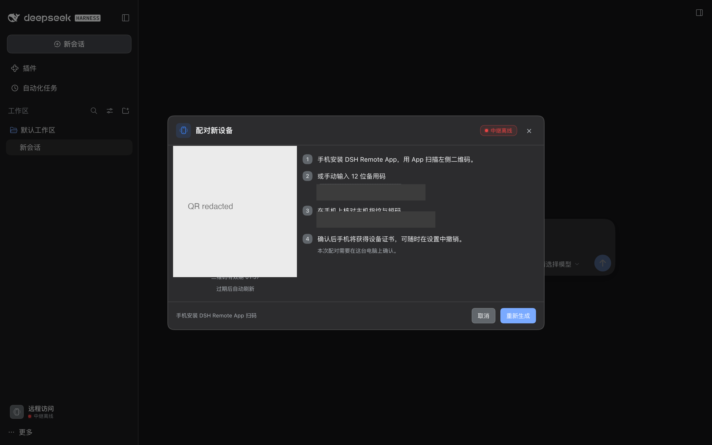
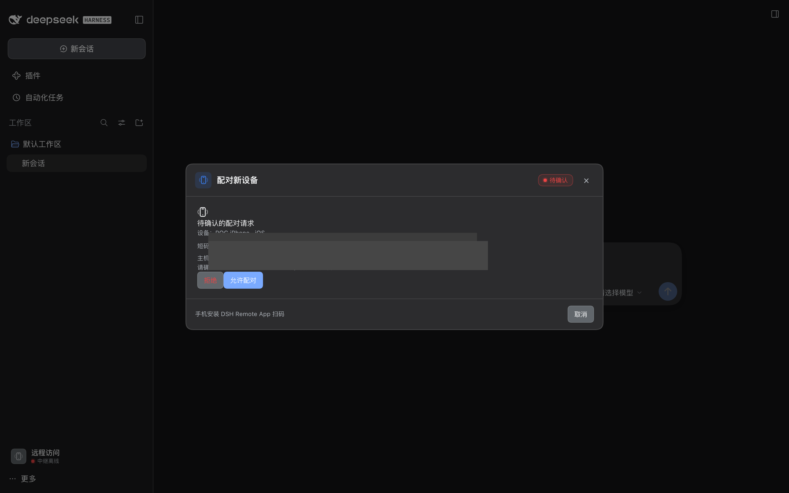

# 方案 B2 · 本地 POC 报告

> 日期：2026-10-19 ｜ 环境：macOS（仅 Command Line Tools，**无 Xcode/Android SDK**）｜ DSH `0.2.1-rc.2` ｜ Node 24
> 结论：**服务端链路（relay 透传 + 主机插件 mTLS 反代 + DSH Web UI/WS）端到端 POC 通过**；手机 WebView mTLS 需在有 Xcode + iPhone 的环境完成最后验证。

---

## 1. POC 清单与状态

| # | POC | 状态 | 证据 |
|---|---|---|---|
| 1 | WebView mTLS | ✅ **macOS WKWebView 已验证**（`npm run poc:webview`：真实 WKWebView 出示客户端证书，服务器确认 `CN=dsh-poc-device`）；⏳ iOS 真机待 Xcode | `poc/webview-mtls/`（Swift 测试工具 + 测试 CA/HTTPS server）；与 iOS 同一套 `WKNavigationDelegate.didReceive challenge` API |
| 1.17 | 原生源码一致性检查 | ✅ `dsh-remoteApp`: `npm run check:native`（JS bridge 方法、模块名、Secure Enclave/KeyStore/客户端证书关键 API、括号平衡）全部通过；不替代真机编译 | `dsh-remoteApp/scripts/check-native-sources.mjs` |
| 1.16 | App 主机诊断 | ✅ host `GET /__dsh_remote/status`（mTLS）：版本/域名/证书到期/relay 连接/设备数；App 设备页展示（host 测试覆盖 200 + 无证书 403） | `packages/host-plugin/lib/server.js`、`dsh-remoteApp/src/lib/devices.ts`、`DevicesScreen` |
| 1.15 | TLS 证书热加载 | ✅ 模拟 acme.sh 覆盖 cert/key 后调用热加载：监听重建、notAfter/端口更新、无需重启进程（测试覆盖；生产由文件 watcher 自动触发） | `RemoteService.reloadTls()`、`test/service.test.js`、`#watchCertFiles` |
| 1.14 | 撤销设备立即断链 | ✅ host 跟踪设备 serial → 活跃 TLS/WS socket；本地管理 API 与远端 tunnel `revoke` 都会立即销毁连接（测试：keep-alive 连接在撤销后关闭） | `packages/host-plugin/lib/server.js`、`test/proxy.test.js` |
| 1.13 | 推送端到端集成 | ✅ `session/event(turn/end)` → RemoteService notifier → connector → **真 relay push** → mock Expo endpoint；断言标题/正文/`{kind}` 且零会话内容（HTTP 200） | `packages/host-plugin/test/push-e2e.test.js` |
| 1.12 | relay 数据面基准 | ✅ 2000 req / 32 并发：**10,912 req/s**，p50 2.03ms / p95 4.06ms / p99 34.21ms，0 错误（本机 loopback，仅作基线） | `poc/bench-relay.js`、`npm run bench` |
| 1.11 | 断线重连可靠性 | ✅ relay 主动断开控制面后 connector 自动重连并重新注册 push token（测试覆盖） | `packages/host-plugin/test/connector.test.js` |
| 1.10 | 客户端推送设置 + relay 连接限制 | ✅ 设置页新增推送开关/冷却；relay 新增 per-IP/全站并发上限（测试覆盖） | `client.js`、`packages/relay/lib/{config,server}.js`、`test/limits.test.js` |
| 1.9 | Android 原生 mTLS HTTP（源码） | ✅ `DshMtlsNetwork.kt`（HttpsURLConnection + KeyManager）；⏳ 无 Android SDK，未编译验证 | `dsh-remoteApp/modules/dsh-mtls/android/.../DshMtlsNetwork.kt` |
| 1.8 | Android CSR（源码） | ✅ AndroidKeyStore P-256 + 手写 PKCS#10 DER（与 iOS 同结构）；⏳ 无 Android SDK，未编译验证 | `dsh-remoteApp/modules/dsh-mtls/android/.../DshMtlsCsr.kt` |
| 1.7 | 设备管理（App → 主机，mTLS 隧道） | ✅ host 侧 `GET /__dsh_remote/devices` + `POST /devices/:id/revoke` 已实现并被测试覆盖（列表/current 标记/撤销/无证书 403）；App `src/lib/devices.ts` + 设备页已接入 | `packages/host-plugin/lib/server.js`、`test/proxy.test.js`、`dsh-remoteApp/src/lib/devices.ts` |
| 1.6 | URLSession 客户端证书（App 原生 HTTP） | ✅ **已验证**（同一 `npm run poc:webview` 中 URLSession 以客户端证书 POST 成功，服务器确认 `CN=dsh-poc-device`）；用途：push token 注册/`pair/status` | `poc/webview-mtls/urlsession-mtls.swift` |
| 1.5 | 设备密钥 + PKCS#10 CSR（P-256） | ✅ **Swift 生成器已验证**：`npm run poc:csr`（Secure Enclave 优先、软件回退）→ host 插件真实设备 CA（openssl 路径）签发 → openssl 校验 CSR 自签名/证书链/公钥一致；iOS 源码在 `dsh-remoteApp/modules/dsh-mtls/ios/DSHMTLSCsr.swift` | `poc/native-csr/`；host 侧 `lib/identity.js` 支持 forge(RSA) + openssl(EC) 两条签发路径 |
| 2 | relay TLS 透传 + SNI 路由 | ✅ **通过** | `packages/relay` 27 项测试（真实 ClientHello 捕获/分片、端到端 `tls.connect` → relay → 自签 TLS server、token 拒绝、未知 SNI 销毁、并发流、CLOSE 帧、控制面 TLS） |
| 3 | 主机插件反代后 DSH UI 全功能 | ✅ **通过** | `poc/run-poc.js`：真实 `dsh web` 实例 + 插件 + relay，`GET /` 200（37,865 bytes DSH HTML），WebSocket `/api/remote.mux` 101 升级成功 |
| 4 | 配对 + 桌面确认 + 设备证书 | ✅ **通过** | POC：`/pairing/start` → App CSR → `/__dsh_remote/pair` pending（SAS）→ 桌面 `/pairing/approve` → 设备证书 → mTLS 访问 |
| 5 | 证书（B2 生产形态） | ✅ 开发自签通过；设备 EC(P-256) CSR 已支持（openssl 签发，适配 Secure Enclave/Keystore）；⏳ 生产 DNS-01 以文档 + acme.sh 为准（插件已实现**证书文件热加载**） | `docs/DEPLOY.md` §3；`lib/identity.js`（forge RSA + openssl EC 两条路径）；`#watchCertFiles` |
| 6 | 安全断言 | ✅ **通过** | 无客户端证书/不受信 CA/已撤销设备 → 403；伪造 `Host`/`X-Forwarded-For`/`X-Real-IP`/`Origin` 不影响身份；`/connect` 被 deny；配对错误密钥限速（10 次后 429） |
| 7 | 客户端 UI：入口 / 配对弹窗 / 桌面确认 | ✅ **通过（真实 DSH 截图）** | 入口在账号行正上方；配对弹窗含真实二维码/备用码/指纹/SAS；`pending` 时显示「待确认的配对请求」+设备名/SAS+「拒绝/允许配对」，点击允许后设备写入并刷新（截图见下） |
| 8 | App 锁 / 生物识别（源码） | ✅ `src/lib/appLock.ts` + `LockScreen`：启动/回前台触发 Face ID/Touch ID/指纹；设备页可开关（本机未编译原生） |
| 9 | App 源码/TS 检查 | ✅ 通过（未编译原生） | `npx tsc --noEmit` exit 0；`expo config` 通过；autolinking 识别 `dsh-mtls`；协议自测 14/14 |

## 2. 端到端 POC 运行结果

```bash
cd dsh-remoteService
npm test                 # 58 tests, 0 fail（protocol + host-plugin + relay + client UI smoke + push）
node poc/run-poc.js      # 端到端：配对→设备 mTLS→relay→DSH UI/WS；需要 dsh CLI 在 PATH
npm run poc:webview      # macOS WKWebView + URLSession 客户端证书 POC（Swift/WebKit；无需 Xcode）
npm run poc:csr          # Swift P-256 CSR → host CA 签发 → openssl 校验（无需 Xcode）
npm run bench            # relay 数据面吞吐/延迟基线（本地）
```

最近一次运行（节选）：
```
[1/8] 安装 host-plugin 到临时 web profile
[2/8] 启动盲中继（dev，临时端口）
[3/8] 启动 dsh web
[4/8] 配置并启用远程访问 → plugin enabled, relay connected
[5/8] 创建配对会话并模拟 App 扫码配对
      App 收到 pending（SAS=N71X-2ABY），模拟桌面确认 → 桌面确认通过
      配对成功 deviceId=d_02eed01be001
[6/8] 用设备证书经 relay 访问 DSH UI
      DSH UI 200，37865 bytes
[7/8] 安全断言：无证书 403 / 头伪造不生效 / deny list 403
[8/8] WebSocket /api/remote.mux 经 relay + mTLS 升级
POC PASS：配对 → 设备 mTLS → relay 透传 → DSH UI/WS 全部打通
```

POC 使用独立临时 `$DSH_HOME`（不会碰用户的真实 DSH 数据），结束后自动清理；`POC_KEEP_HOME=1` 可保留现场。
`POC_TRANSPORT=direct` 可绕过 relay 数据面直连主机插件 TLS 监听（用于定位 relay/插件两侧问题）。

## 3. 真实 DSH UI 截图（客户端插件）





> 截图来自真实 `dsh web` 实例（临时 home）加载本插件：入口在账号行上方；配对弹窗展示了真实二维码、12 位备用码、主机指纹与「本次配对需要在这台电脑上确认」；待确认卡片展示设备名、SAS、拒绝/允许按钮。

## 4. 交付物

| 路径 | 内容 |
|---|---|
| `packages/protocol` | 配对 URI/SAS/12 位码、relay 控制消息、二进制流帧、管理 API 常量 |
| `packages/host-plugin` | DSH 插件：Host 半（身份/设备 CA/配对/mTLS/反代/relay 连接器/审计/证书热加载）+ Client 半（footer 入口/配对弹窗/设置页/设备撤销/审计） |
| `packages/relay` | 自托管盲中继：443 TLS 透传 + 80 跳转/healthz + 8443 WSS 控制面 + token CLI + Dockerfile/compose + 部署 README |
| `poc/` | `run-poc.js` 端到端验收脚本 + 设备 CSR/HTTPS 工具 |
| `docs/DEPLOY.md` | B2 生产部署（DNS/证书/relay/插件/App/运维/安全红线/排障） |
| `docs/ADMIN-API.md` | 本机管理 API + 远程隧道 API 契约 |
| `../dsh-remoteApp` | Expo App：配对/WebView/设备页 + `modules/dsh-mtls`（iOS/Android）骨架 |

## 5. 尚未完成 / 下一步

1. **iOS 真机 WebView mTLS**：macOS WKWebView + Swift CSR 均已独立验证；剩余用 Xcode + iPhone 验证 Secure Enclave/Keychain 身份来源与 App 集成。
2. **App 原生密钥/CSR + 原生 mTLS HTTP**：✅ iOS Swift 生成器 + `installCertificate` + `requestWithClientCert`（URLSession）已实现并独立验证；⏳ 需 Xcode 编译 + 真机 Keychain/Secure Enclave 验收；Android（Keystore+BouncyCastle）待实现。
3. **生产证书自动化**：当前按 `DEPLOY.md` 用 acme.sh 手工/定时签发；可加 relay 侧 ACME DNS-01 helper（B2 仍要求 DNS 凭据只在主机）。
4. **推送**：✅ host/relay 零内容推送链路 + 测试；⏳ App 原生 mTLS HTTP 客户端（`requestWithClientCert`）与 EAS/APNs 凭据（真机里程碑）。
5. **client UI 桌面确认按钮**：✅ 已补齐（pending 卡片 + 允许/拒绝 + 刷新 + 测试）。
6. **生产部署**：需要用户提供 VPS + 域名（或按 `DEPLOY.md` 自行部署）；relay 控制面必须用真实证书（`--dev` 仅本机）。
7. **加固收尾**：✅ 远程响应安全头/请求体上限/`/open-in-app` deny、relay per-IP 连接限制、断线重连；⏳ Android 编译、换机/撤销演练、CSP 评估。
8. **部署产物校验**：✅ `docker compose config` 通过、launchd plist `plutil -lint` 通过；本机 Docker daemon 未运行，镜像构建需在部署机上执行。

## 6. 已知限制（POC 级别）

- **dev 自签主机证书**仅用于本地 POC；生产必须配置 B2 的 DNS-01 证书（否则手机 WebView 不信任）。
- relay 控制面在 dev 模式是 `ws://`（明文 token）；公网必须 `wss://`。
- `relayTlsInsecure` 配置目前未用于 wss 自签（dev 用 ws）；生产用受信证书即可。
- 手机 WebView 内不做证书 pinning（依赖公共 CA；B2 下 relay 无法拿同名证书，残余风险见评估 §4.8）。
- 反代路径 allow/deny 目前是配置 + 默认清单；DSH 升级后需复核新增"本机副作用"路由。
